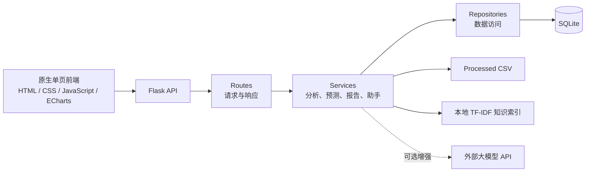

# ViralPick AI

> 基于 Python 的多平台电商智能经营与增长决策平台

[](https://github.com/kechanghao666/ViralPick-AI/actions/workflows/ci.yml)

ViralPick AI 面向课程实践、本地演示和轻量经营分析场景，将商品、销售、订单、评论、库存、售后、流量、广告与内容数据统一接入，形成“数据治理 → 经营分析 → 增长判断 → 趋势预测 → 报告输出 → 智能问答”的完整闭环。

项目不是简单的数据可视化页面。后端已经采用 `routes → services → repositories` 分层结构，前端是一套无需构建工具的原生单页应用，并包含账号权限、团队协作、审计、报告分享、备份恢复和自动化任务等产品化基础能力。

## 项目概览

| 项目 | 说明 |
| --- | --- |
| 中文名称 | 基于 Python 的多平台电商智能经营与增长决策平台 |
| 当前版本 | `0.2.0` |
| 作者 | 柯长浩（20241524） |
| 后端 | Python、Flask、pandas、numpy、scikit-learn、jieba |
| 前端 | HTML、CSS、JavaScript、ECharts |
| 数据库 | SQLite |
| 报告导出 | DOCX、PDF、HTML、Markdown |
| 运行方式 | 本地 Python、Gunicorn、Docker、Docker Compose |

## 核心功能

系统前端保持七个主要功能中心：

1. **经营驾驶舱**：销售额、订单量、客单价、转化率、退款率、投产比、经营趋势、风险提醒和今日动作。
2. **数据接入中心**：CSV / Excel 上传、数据类型识别、字段映射、质量检查、错误报告和导入任务记录。
3. **商品增长中心**：商品货架、销售排行、价格带分析、类目表现、爆品潜力和风险商品识别。
4. **用户口碑中心**：评论情绪、好评关键词、差评归因、用户痛点和售后联动。
5. **投放内容中心**：广告花费、曝光、点击、转化、ROI、素材表现和内容优化建议。
6. **趋势预测中心**：单商品、类目或全局口径的销量与销售额预测，以及补货、滞销和售后风险提示。
7. **经营报告中心**：生成正式经营分析报告，并支持多格式导出、定时任务和只读分享链接。

此外，系统还包含：

- 全局智能经营助手：结合当前商品、经营数据和本地知识库回答问题。
- 本地 TF-IDF 字符 n-gram 知识索引：无需外部向量数据库即可完成业务资料检索。
- 可选大模型增强：当前适配 Spark X 风格的 `chat/completions` 接口；默认关闭，异常时自动回退本地规则答案。
- 登录、工作空间、团队邀请、角色权限和审计日志。
- 爆品评分模型版本与权重管理。
- 报告计划、邮件交付记录、失败重试和品牌模板。
- 运维状态、Webhook 告警、SQLite 备份校验与受控恢复。
- 平台连接与授权流程演示接口；真实平台同步必须使用合法授权的官方 API。

## 技术实现



### 爆品潜力评分

系统默认评分模型由七个维度组成，也支持在数据库中创建并激活自定义模型版本：

| 维度 | 默认权重 |
| --- | ---: |
| 销量增长率 | 20% |
| 销售额增长率 | 20% |
| 好评率 | 15% |
| 评论热度 | 10% |
| 价格竞争力 | 15% |
| 内容互动表现 | 15% |
| 转化率 | 5% |

### 评论与预测

- 评论分析使用 `jieba` 分词、停用词过滤和规则归因，主流程不依赖大模型。
- 趋势预测默认使用 scikit-learn `LinearRegression`，异常时回退到 numpy 线性拟合。
- `/api/forecast/sales` 支持 `product_id`、`category` 或全局三种预测口径。
- 报告和助手优先使用本地经营数据与规则；只有显式启用后才调用外部模型。

## 数据规模与合规边界

仓库中的 `data/processed/` 是可复现的课程演示数据。当前数据规模如下：

| 数据集 | 记录数 |
| --- | ---: |
| 商品 | 24 |
| 每日销售 | 2,160 |
| 每日订单经营 | 2,160 |
| 评论 | 543 |
| 库存 | 720 |
| 售后 | 72 |
| 广告投放 | 540 |
| 流量 | 2,160 |
| 内容运营 | 96 |
| 视频互动 | 24 |
| 市场对照数据 | 72 |

数据来源与使用边界：

- 商品字段参考 JD.com 公开电商数据结构。
- 评论语言与情感结构参考 ChineseNlpCorpus `online_shopping_10_cats`。
- 销售、订单、库存、投放、流量、趋势和市场对照指标为本地演示或派生经营数据。
- 项目不抓取受限平台页面，不绕过平台限制，不应将演示数据描述为真实平台实时数据。
- 正式使用时应导入商家自有、已授权或合法公开来源的数据。

详细说明见 [`data/README.md`](data/README.md)。

## 快速启动

### 1. 环境要求

- Python 3.11 或更高版本
- pip
- Git
- 可选：Node.js（仅用于 JavaScript 语法检查）
- 可选：Docker Desktop

### 2. Windows PowerShell 启动

```powershell
git clone https://github.com/kechanghao666/ViralPick-AI.git
Set-Location ViralPick-AI

py -3.11 -m venv .venv
Set-ExecutionPolicy -Scope Process -ExecutionPolicy Bypass
.\.venv\Scripts\Activate.ps1

python -m pip install --upgrade pip
python -m pip install -r requirements.txt

# 首次克隆时创建演示数据库
python scripts\init_database.py --force
python scripts\migrate_database.py

# 启动前后端一体服务
python backend\app.py
```

如果电脑没有 `py -3.11`，可改用：

```powershell
python -m venv .venv
```

### 3. macOS / Linux 启动

```bash
git clone https://github.com/kechanghao666/ViralPick-AI.git
cd ViralPick-AI

python3 -m venv .venv
source .venv/bin/activate

python -m pip install --upgrade pip
python -m pip install -r requirements.txt
python scripts/init_database.py --force
python scripts/migrate_database.py
python backend/app.py
```

### 4. 访问系统

- 系统首页：<http://127.0.0.1:5000>
- 存活检查：<http://127.0.0.1:5000/api/health>
- 就绪检查：<http://127.0.0.1:5000/api/ready>

首次初始化会创建本地演示管理员：

```text
邮箱：demo@viralpick.ai
密码：ViralPick@2026
```

该账号仅用于本地课程演示。公开部署前必须通过环境变量更换默认邮箱和密码，并重新初始化数据库。

### 5. 已有数据库升级

如果本地已经存在 `data/database/viralpick.db`，不要再次使用 `--force`，否则会覆盖当前数据库。升级结构时执行：

```powershell
python scripts\migrate_database.py --dry-run
python scripts\migrate_database.py
```

### 6. 可选：提前构建本地知识库

系统在首次查询时会自动生成知识索引，也可以手动执行：

```powershell
python scripts\build_knowledge_base.py
```

## Docker 启动

```powershell
docker compose up --build
```

随后访问 <http://127.0.0.1:5000>，使用上面的演示管理员登录。

停止并清理容器：

```powershell
docker compose down
```

当前 Compose 配置面向单机演示，没有为 SQLite 配置持久化卷；容器重建时不要把它当作生产数据存储方案。生产部署前还应修改默认账号、收紧 CORS、配置 HTTPS 和持久化数据库。

## 环境变量

配置项统一通过 `os.getenv` 读取，`.env.example` 是配置参考文件，项目当前不会自动加载 `.env`。请在 PowerShell、Shell、Docker 或部署平台中注入变量。

PowerShell 示例：

```powershell
$env:VIRALPICK_ENV = "production"
$env:VIRALPICK_SERVE_FRONTEND = "1"
$env:VIRALPICK_AUTH_REQUIRED = "1"
$env:VIRALPICK_DEFAULT_ADMIN_EMAIL = "admin@example.com"
$env:VIRALPICK_DEFAULT_ADMIN_PASSWORD = "请替换为强密码"

python scripts\init_database.py --force
python backend\app.py
```

常用变量：

| 变量 | 默认值 / 用途 |
| --- | --- |
| `VIRALPICK_API_HOST` | `127.0.0.1` |
| `VIRALPICK_API_PORT` | `5000` |
| `VIRALPICK_DB_PATH` | `data/database/viralpick.db` |
| `VIRALPICK_SERVE_FRONTEND` | 开发环境默认开启 |
| `VIRALPICK_AUTH_REQUIRED` | 生产环境默认开启 |
| `VIRALPICK_CORS_ORIGINS` | 本地默认 `*`，生产环境应指定域名 |
| `VIRALPICK_RATE_LIMIT_ENABLED` | 生产环境默认开启进程内限流 |
| `VIRALPICK_LLM_ENABLED` | 默认 `0`，不主动调用外部模型 |
| `VIRALPICK_LLM_API_PASSWORD` | 外部模型凭据，禁止提交到 Git |
| `VIRALPICK_REPORT_DELIVERY_ENABLED` | 默认 `0`，控制 SMTP 报告交付 |
| `VIRALPICK_ALERTS_ENABLED` | 默认 `0`，控制 Webhook 告警 |

完整变量见 [`.env.example`](.env.example) 和 [`docs/deployment.md`](docs/deployment.md)。

## 测试与验证

静态检查和测试套件：

```powershell
python -m compileall backend scripts tests
node --check frontend\assets\js\api.js
node --check frontend\assets\js\app.js
node --check frontend\assets\js\charts.js
node --check frontend\assets\js\format.js
node --check frontend\assets\js\report.js
python -m pytest -q
```

服务启动后可在另一个终端运行完整 HTTP smoke test：

```powershell
python scripts\smoke_test.py --base-url http://127.0.0.1:5000 --check-frontend
```

GitHub Actions 会自动执行 Python 编译、前端 JavaScript 语法检查、pytest 和 Docker 镜像构建。

## 项目结构

```text
ViralPick-AI/
├── backend/
│   ├── app.py                 # Flask 应用入口
│   ├── config.py              # 环境变量与路径配置
│   ├── db.py                  # SQLite 访问基础设施
│   ├── routes/api.py          # API 路由
│   ├── services/              # 分析、预测、报告、助手等业务服务
│   ├── repositories/          # 数据仓储层
│   └── utils/                 # 校验与响应工具
├── data/
│   ├── processed/             # 可复现的演示经营数据
│   ├── import_examples/       # 前端导入示例
│   └── README.md              # 数据来源与合规说明
├── frontend/
│   ├── index.html             # 单页应用结构
│   └── assets/                # CSS、JavaScript、ECharts 与商品图片
├── scripts/                   # 初始化、迁移、知识库、自动化和 smoke 脚本
├── tests/                     # pytest 自动化测试
├── docs/                      # 需求、设计、接口、部署与产品化文档
├── Dockerfile
├── docker-compose.yml
├── requirements.txt
└── wsgi.py                    # Gunicorn 入口
```

## 主要 API

| 能力 | 代表接口 |
| --- | --- |
| 健康与就绪 | `GET /api/health`、`GET /api/ready` |
| 登录与权限 | `POST /api/auth/login`、`GET /api/auth/me` |
| 经营驾驶舱 | `GET /api/dashboard/executive` |
| 数据导入 | `POST /api/imports/preview`、`POST /api/imports/commit` |
| 商品与评分 | `GET /api/products`、`GET /api/hot-products/scoring` |
| 评论与口碑 | `GET /api/comments/keywords` |
| 投放与库存 | `GET /api/marketing/summary`、`GET /api/inventory/summary` |
| 趋势预测 | `GET /api/forecast/sales` |
| 经营报告 | `POST /api/reports/generate`、`GET /api/reports/<id>/export` |
| 智能助手 | `POST /api/assistant/chat` |
| 团队与审计 | `GET /api/team/members`、`GET /api/audit/logs` |
| 运维与备份 | `GET /api/ops/status`、`POST /api/ops/backups` |

完整接口见 [`docs/api.md`](docs/api.md)。

## 文档索引

- [需求分析](docs/requirements_analysis.md)
- [系统设计](docs/system_design.md)
- [数据库设计](docs/database_design.md)
- [API 文档](docs/api.md)
- [前端设计说明](docs/frontend_design.md)
- [部署说明](docs/deployment.md)
- [权限模型](docs/permission_model.md)
- [数据库迁移](docs/database_migrations.md)
- [产品化就绪清单](docs/product_readiness.md)

## 当前边界

本项目已经具备完整课程展示与单机运行能力，但不应直接等同于成熟商业 SaaS：

- SQLite 适合课程演示和轻量单机部署，不适合高并发、多实例写入。
- 平台连接模块目前用于演示授权、状态和同步流程，不代表已接通所有平台真实接口。
- 当前尚未提供完整租户数据隔离、MFA、密码找回和生产级分布式任务队列。
- 内置限流是单进程内存实现，多实例部署需要 API 网关或 Redis 等外部限流。
- 外部大模型、SMTP 和 Webhook 均默认关闭，凭据必须通过 Secret 或环境变量注入。
- 仓库中的经营指标为课程演示数据，只能用于研究、开发和本地展示。

## 项目声明

本项目主要用于课程实践、技术学习和项目展示。使用者应遵守数据来源平台的服务条款、隐私要求和相关法律法规，不得将演示数据冒充真实平台实时经营数据。
