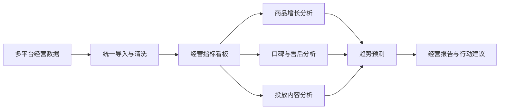

# ViralPick AI 需求分析文档

> 项目名称：ViralPick AI  
> 中文定位：基于 Python 的多平台电商智能经营与增长决策平台  
> 文档性质：项目实施前需求分析  
> 调研对象：多平台网店经营者、店铺运营人员、商品运营人员  
> 资料检索日期：2026-07-03  

---

## 1. 文档目的

本文档不是对已实现系统的功能介绍，而是在项目开发前，从电商经营行业现状出发，分析目标用户面临的真实问题，并据此推导系统应具备的能力。

需求分析的核心目标是回答四个问题：

| 问题 | 本文档回答方式 |
|---|---|
| 行业中存在什么问题 | 通过电商经营、数据管理、库存、投放、评论口碑等资料调研归纳痛点 |
| 用户真正需要什么 | 分析店铺老板、运营人员、商品人员、数据整理人员的任务目标 |
| 系统应该解决什么 | 将行业痛点转化为业务需求、用户需求和系统需求 |
| 如何判断系统有效 | 给出可验证的验收标准和需求追踪关系 |

---

## 2. 需求分析方法依据

软件需求分析不是简单罗列功能，而是把业务问题转化为可设计、可开发、可验证的系统需求。

| 调研依据 | 对本文档的启发 |
|---|---|
| IBM 对需求管理的定义强调：需求需要被记录、分析、优先级排序、确认和追踪 | 本文档按“问题 -> 需求 -> 功能 -> 验收”组织 |
| ISO/IEC/IEEE 29148 强调需求工程贯穿系统生命周期，并要求需求具有良好属性 | 本文档将需求写成清晰、可验证、可追踪的条目 |
| 软件工程实践通常区分业务需求、用户需求、功能需求和非功能需求 | 本文档不只写页面功能，还写业务目标、数据质量、性能、易用性和合规边界 |

---

## 3. 行业背景调研

### 3.1 电商仍是高频经营场景

国家统计局数据显示，2025 年 1—6 月全国网上零售额为 74295 亿元，同比增长 8.5%；其中实物商品网上零售额为 61191 亿元，占社会消费品零售总额比重为 24.9%。这说明网店经营已经不是单一销售渠道，而是商家日常经营的重要组成部分。

同时，商务部相关电子商务报告也指出，电子商务报告需要服务于企业经营战略制定。这意味着电商系统不能只停留在“统计数据”，而应能支持经营分析、趋势判断和决策落地。

### 3.2 商家经营从单平台转向多平台

当前商家通常同时经营多个销售触点，例如天猫、京东、拼多多、抖音电商、快手、小红书、视频号、私域商城等。多平台经营提高了获客机会，但也带来新的管理压力：

- 商品、订单、广告、流量、评论、售后数据分散在不同后台。
- 不同平台字段口径不一致，人工整理成本高。
- 库存、投放、内容、口碑之间缺少联动分析。
- 经营者很难从大量表格中快速看出今天该处理什么。

### 3.3 经营决策越来越依赖数据质量

零售数据质量问题会直接影响库存、营销、客户体验和预测模型。行业资料指出，碎片化、不一致、不可信的数据会拖慢决策，导致库存错配、营销失效和运营成本上升。

因此，本项目的需求重点不是“做一个漂亮看板”，而是建立从数据接入、清洗、分析到经营建议输出的闭环。

---

## 4. 行业痛点分析

### 4.1 痛点一：经营数据分散，人工汇总效率低

| 观察 | 分析 |
|---|---|
| 多平台店铺后台各自提供数据导出，字段命名和统计口径不统一 | 商家需要手动下载、复制、清洗和合并表格 |
| Excel 分析容易卡顿，重复制作图表和周报 | 运营人员把大量时间花在整理数据，而不是分析问题 |
| 店铺老板看到的是滞后的汇报 | 经营动作往往慢于市场变化 |

**需求结论：** 系统必须提供统一的数据接入中心，支持多类型文件上传、字段自动识别、字段映射、质量检查和导入确认。

### 4.2 痛点二：经营结果看得见，但原因看不清

商家常见问题不是“不知道销售额是多少”，而是无法快速判断：

- 销售增长来自哪个类目、商品或投放动作。
- 销售下滑是流量问题、价格问题、口碑问题还是库存问题。
- 高销售商品是否真的值得继续加码。
- 某个商品销售好，但退款和差评是否正在积累风险。

**需求结论：** 系统不能只展示销售额和订单数，还要把商品、口碑、库存、投放和售后数据放在同一个经营视角下分析。

### 4.3 痛点三：多平台库存管理容易出现缺货和积压

多渠道库存管理资料显示，多平台销售会增加缺货、超卖、库存不一致和需求预测困难。对中小商家而言，库存问题通常有两种极端：

| 问题 | 后果 |
|---|---|
| 热卖商品补货不及时 | 错失销售机会，影响平台权重和用户体验 |
| 滞销商品库存积压 | 占用现金流，增加仓储和促销压力 |

**需求结论：** 系统需要结合销售趋势、库存数量、滞销天数和预测结果，给出补货关注和滞销预警。

### 4.4 痛点四：广告与内容投放数据割裂，ROI 难判断

营销数据资料指出，团队往往使用大量营销工具和数据源，不同平台指标口径不同，导致“花费去了哪里、哪个活动带来转化”难以回答。

对电商商家而言，投放问题主要表现为：

- 只知道花费和曝光，不知道是否带来成交。
- 素材表现、商品表现、订单结果没有打通。
- 不同平台 ROI 口径不一致，难以比较。
- 内容种草、广告点击、商品成交之间缺少关联分析。

**需求结论：** 系统需要建立投放内容中心，统一展示广告花费、曝光、点击、转化、成交金额、ROI 和内容素材表现。

### 4.5 痛点五：评论和商品内容直接影响转化与退货

商品内容和用户评价会显著影响消费者决策。相关消费者研究显示，商品信息不一致会导致消费者放弃购买，商品与页面描述不符也会引发退货。评论研究也表明，评分、评论内容、评论数量会影响购买决策。

对商家而言，评论不是简单的“好评率”，而是重要的经营信号：

- 好评关键词反映商品卖点。
- 差评关键词反映产品缺陷和服务问题。
- 用户痛点可以反向指导详情页、客服话术和商品优化。
- 负面评论与售后原因结合，可以提前发现风险商品。

**需求结论：** 系统需要提供用户口碑中心，对评论进行情绪判断、关键词提取、痛点归因，并与售后风险联动。

### 4.6 痛点六：经营报告依赖人工整理，结论不够及时

很多商家仍依赖人工周报或月报做复盘。问题在于：

- 报告生成慢，结论滞后。
- 图表和文字分离，缺少明确行动建议。
- 不同运营人员对数据解释口径不同。
- 老板更需要“今天做什么”，而不是大量指标截图。

**需求结论：** 系统需要自动生成结构化经营报告，将销售、商品、口碑、投放、库存、售后和趋势汇总为可执行动作。

---

## 5. 目标用户需求

### 5.1 店铺老板

| 经营问题 | 用户需求 |
|---|---|
| 今天店铺整体表现如何 | 快速看到销售额、订单量、客单价、投产比和风险数量 |
| 哪些问题需要马上处理 | 系统自动给出今日重点动作 |
| 哪些商品值得加码 | 看到增长机会和重点商品 |
| 是否存在经营风险 | 看到库存、口碑、售后、趋势异常 |

### 5.2 店铺运营人员

| 工作问题 | 用户需求 |
|---|---|
| 多平台数据难整理 | 能上传文件并自动识别字段 |
| 销售变化原因难判断 | 能按商品、类目、价格带和趋势分析 |
| 活动复盘耗时 | 自动生成图表和经营报告 |
| 需要快速调整运营动作 | 系统提供商品、投放、口碑和库存建议 |

### 5.3 商品运营人员

| 工作问题 | 用户需求 |
|---|---|
| 不知道哪些商品有潜力 | 系统计算商品增长评分 |
| 不知道哪些商品有风险 | 系统识别低评分、差评、滞销、退款商品 |
| 商品卖点不清晰 | 从好评关键词和评论中提取卖点 |
| 定价和价格带缺少依据 | 分析价格区间销量和销售额分布 |

### 5.4 数据整理人员

| 工作问题 | 用户需求 |
|---|---|
| 不同平台导出的字段不同 | 系统支持字段别名识别和映射 |
| 导入前担心数据错误 | 系统展示预览行和质量检查结果 |
| 数据需要持续更新 | 支持追加、覆盖、按日期合并 |

---

## 6. 问题到解决方案映射

| 行业问题 | 系统解决方案 | 对应中心 |
|---|---|---|
| 多平台数据分散 | 文件导入、字段识别、字段映射、质量检查 | 数据接入中心 |
| 经营结果难复盘 | 汇总销售、订单、转化、投产比、风险和机会 | 经营驾驶舱 |
| 商品增长机会难判断 | 商品评分、排行、价格带、类目贡献、风险标签 | 商品增长中心 |
| 评论价值未被利用 | 情绪分析、关键词提取、痛点归因、售后联动 | 用户口碑中心 |
| 投放效果难比较 | 统一广告和内容指标，计算 ROI 与素材效果 | 投放内容中心 |
| 库存和趋势判断滞后 | 销量预测、销售额预测、补货关注、滞销预警 | 趋势预测中心 |
| 人工报告慢 | 自动生成综合经营报告和执行动作清单 | 经营报告中心 |

---

## 7. 系统建设目标

本系统的建设目标不是替代 ERP、财务软件或平台后台，而是提供一个轻量、可运行、可展示、面向经营决策的数据分析平台。

| 目标 | 具体说明 |
|---|---|
| 降低数据整理成本 | 用户无需手工统一字段，系统辅助识别和映射 |
| 提升经营判断速度 | 首页直接展示经营结果、风险和今日动作 |
| 识别商品增长机会 | 用评分模型筛选高潜商品和风险商品 |
| 发现用户真实反馈 | 从评论中提取好评卖点、差评原因和用户痛点 |
| 评估投放有效性 | 统一查看曝光、点击、转化、成交和 ROI |
| 辅助补货和控库存 | 基于历史销售和库存状态输出预测建议 |
| 沉淀复盘材料 | 自动形成可复制、可导出的经营分析报告 |

---

## 8. 业务需求

| 编号 | 业务需求 | 优先级 |
|---|---|---|
| BR-01 | 商家能够将多平台经营文件导入统一系统 | 高 |
| BR-02 | 商家能够在 3 分钟内了解当前店铺经营状态 | 高 |
| BR-03 | 商家能够识别值得重点运营的商品 | 高 |
| BR-04 | 商家能够发现口碑、库存、售后和趋势风险 | 高 |
| BR-05 | 商家能够判断投放内容是否带来有效成交 | 中 |
| BR-06 | 商家能够生成结构化经营汇报和行动清单 | 高 |
| BR-07 | 系统应保留后续接入真实平台接口的扩展空间 | 中 |

---

## 9. 功能需求

### 9.1 数据接入需求

| 编号 | 需求描述 | 验证方式 |
|---|---|---|
| FR-01 | 支持上传 CSV 和 Excel 文件 | 上传文件后返回预览结果 |
| FR-02 | 自动识别商品、销售、订单、评论、库存、售后、流量、广告、内容运营等数据类型 | 上传不同类型文件并识别正确 |
| FR-03 | 自动推荐字段映射关系 | 展示系统字段与源文件字段对应关系 |
| FR-04 | 导入前执行质量检查 | 提示缺失字段、重复主键、日期异常、金额异常 |
| FR-05 | 支持追加、覆盖、按日期合并三种导入策略 | 导入后检查数据库结果 |

### 9.2 经营驾驶舱需求

| 编号 | 需求描述 | 验证方式 |
|---|---|---|
| FR-06 | 展示销售额、订单量、客单价、投产比 | 首页指标正常显示 |
| FR-07 | 展示近 30 日销售趋势 | 趋势图可正常渲染 |
| FR-08 | 展示类目贡献、增长机会和风险预警 | 对应模块有数据、有商品、有建议 |
| FR-09 | 输出今日重点动作 | 首页出现可执行建议 |

### 9.3 商品增长需求

| 编号 | 需求描述 | 验证方式 |
|---|---|---|
| FR-10 | 展示商品图片、平台、店铺、价格、销量、评分 | 商品列表字段完整 |
| FR-11 | 支持搜索、筛选和排序 | 输入条件后结果变化 |
| FR-12 | 计算商品增长评分 | 商品评分在 0-100 范围内 |
| FR-13 | 展示商品排行、价格带、类目表现 | 图表和表格可正常展示 |
| FR-14 | 输出商品运营动作建议 | 高潜商品和风险商品有建议 |

### 9.4 用户口碑需求

| 编号 | 需求描述 | 验证方式 |
|---|---|---|
| FR-15 | 展示评论情绪分布 | 情绪图表可展示 |
| FR-16 | 提取好评关键词和差评关键词 | 页面展示关键词和频次 |
| FR-17 | 总结用户痛点和需求 | 页面展示痛点和需求摘要 |
| FR-18 | 支持切换商品查看口碑结果 | 切换商品后数据刷新 |

### 9.5 投放内容需求

| 编号 | 需求描述 | 验证方式 |
|---|---|---|
| FR-19 | 展示广告花费、曝光、点击、转化、成交金额 | 指标正常显示 |
| FR-20 | 计算并展示 ROI | ROI 显示正确 |
| FR-21 | 展示素材或内容主题表现 | 排行和列表可展示 |
| FR-22 | 输出投放优化建议 | 页面展示可执行建议 |

### 9.6 趋势预测需求

| 编号 | 需求描述 | 验证方式 |
|---|---|---|
| FR-23 | 支持未来 7、14、30 天预测 | 不同周期返回预测数据 |
| FR-24 | 展示历史曲线和预测曲线 | 图表正常渲染 |
| FR-25 | 输出趋势方向 | 页面展示增长、下降或稳定 |
| FR-26 | 输出补货和滞销关注 | 列表展示商品和处理建议 |

### 9.7 经营报告与助手需求

| 编号 | 需求描述 | 验证方式 |
|---|---|---|
| FR-27 | 一键生成综合经营报告 | 报告包含完整章节 |
| FR-28 | 报告包含经营概览、商品、口碑、投放、库存、售后、趋势和执行动作 | 检查报告结构 |
| FR-29 | 支持复制和导出报告 | 按钮操作成功 |
| FR-30 | 智能助手可回答通用问题和经营问题 | 输入问题后返回可读答案 |
| FR-31 | 助手回答不暴露底层技术过程 | 前端不出现技术调用状态 |

---

## 10. 数据需求

| 数据类型 | 关键字段 | 用途 |
|---|---|---|
| 商品数据 | 商品 ID、商品名称、平台、店铺、品牌、类目、价格、图片、卖点 | 商品展示、商品评分、类目分析 |
| 销售数据 | 日期、商品 ID、销量、销售额、订单数、件单价 | 销售趋势、商品排行、预测 |
| 订单数据 | 日期、平台、订单数、支付金额、客单价、退款金额、转化率 | 经营驾驶舱、退款分析 |
| 评论数据 | 商品 ID、评论内容、评分、情绪标签 | 口碑分析、痛点提取 |
| 库存数据 | 商品 ID、库存、可售库存、补货阈值、滞销天数 | 补货建议、滞销预警 |
| 售后数据 | 商品 ID、售后原因、退款金额、售后状态 | 风险识别、口碑联动 |
| 流量数据 | 商品 ID、访客、浏览、加购、收藏、转化率 | 转化分析 |
| 广告数据 | 花费、曝光、点击、转化、成交金额、ROI | 投放效果分析 |
| 内容运营数据 | 内容类型、主题、曝光、互动、引导成交 | 内容表现分析 |

---

## 11. 非功能需求

| 类型 | 需求 |
|---|---|
| 易用性 | 用户不需要理解数据库结构即可完成文件导入和经营查看 |
| 可视化 | 页面应具有数据大屏风格，重点指标清晰，图表和商品图片完整 |
| 性能 | 常规演示数据量下，页面加载和接口响应应保持流畅 |
| 可维护性 | 后端按路由、仓储、服务、工具分层，避免接口逻辑和业务逻辑混杂 |
| 可扩展性 | 后续可扩展平台接口、更多预测模型、更多报告模板 |
| 合规性 | 不抓取受限页面，不绕过平台限制，数据应来自商家自有、授权或合法公开来源 |
| 可验证性 | 每条核心需求应能通过接口测试、页面检查或数据检查验证 |

---

## 12. 需求追踪矩阵

| 行业痛点 | 业务需求 | 功能需求 |
|---|---|---|
| 数据分散、人工整理慢 | BR-01 | FR-01 至 FR-05 |
| 老板无法快速看清经营状态 | BR-02 | FR-06 至 FR-09 |
| 商品机会和风险难识别 | BR-03、BR-04 | FR-10 至 FR-14 |
| 评论和售后没有形成洞察 | BR-04 | FR-15 至 FR-18 |
| 投放效果难判断 | BR-05 | FR-19 至 FR-22 |
| 库存与趋势判断滞后 | BR-04 | FR-23 至 FR-26 |
| 人工汇报慢、结论不统一 | BR-06 | FR-27 至 FR-31 |

---

## 13. 验收标准

| 编号 | 验收标准 |
|---|---|
| AC-01 | 系统启动后可直接进入经营页面 |
| AC-02 | 可上传至少 9 类经营数据文件并完成预览 |
| AC-03 | 数据接入中心能展示字段映射和质量检查结果 |
| AC-04 | 经营驾驶舱能展示销售、订单、趋势、机会和风险 |
| AC-05 | 商品增长中心能展示商品图片、评分、排行和建议 |
| AC-06 | 用户口碑中心能展示情绪、关键词、痛点和商品切换结果 |
| AC-07 | 投放内容中心能展示花费、曝光、点击、成交和 ROI |
| AC-08 | 趋势预测中心能展示预测曲线、补货关注和滞销提醒 |
| AC-09 | 经营报告中心能生成完整综合报告 |
| AC-10 | 智能助手能回答通用问题和经营分析问题 |
| AC-11 | 页面不出现与经营主流程无关的后台管理入口 |
| AC-12 | 自动化测试、接口检查和前端语法检查通过 |

---

## 14. 调研结论

通过行业调研可以得出，本项目要解决的核心矛盾不是“缺少图表”，而是商家在多平台经营中面临的数据分散、分析滞后、库存和投放难判断、口碑信息未被利用、经营报告依赖人工整理等问题。

因此，ViralPick AI 的需求定位应落在以下闭环上：

系统最终应帮助商家回答三个经营问题：

1. 当前店铺经营是否健康。
2. 哪些商品、内容和风险最值得关注。
3. 今天应该采取哪些具体经营动作。

---

## 15. 参考资料

- [IBM：What is requirements management?](https://www.ibm.com/think/topics/what-is-requirements-management)
- [IEEE/ISO/IEC 29148-2018 Requirements Engineering](https://standards.ieee.org/ieee/29148/6937/)
- [国家统计局：2025 年 6 月份社会消费品零售总额](https://www.stats.gov.cn/xxgk/sjfb/zxfb2020/202507/t20250715_1960409.html)
- [全国电子商务公共服务网：《中国电子商务报告（2024）》发布](https://dzswgf.mofcom.gov.cn/news/5/2025/11/1762844725887.html)
- [数跨境 BI：跨境电商卖家自助分析工具](https://www.shukuajing.com/)
- [NetSuite：Multichannel Inventory Management Challenges](https://www.netsuite.com/portal/resource/articles/inventory-management/multichannel-inventory-management.shtml)
- [Funnel：Marketing data sources and fragmented reporting](https://funnel.io/blog/marketing-data-sources)
- [Soda：Data Quality in Retail](https://soda.io/blog/data-quality-in-retail)
- [Salsify：2025 Consumer Research Report](https://www.salsify.com/resources/report/2025-consumer-research)
- [Northwestern Medill Spiegel Research Center：How Online Reviews Influence Sales](https://spiegel.medill.northwestern.edu/how-online-reviews-influence-sales/)
