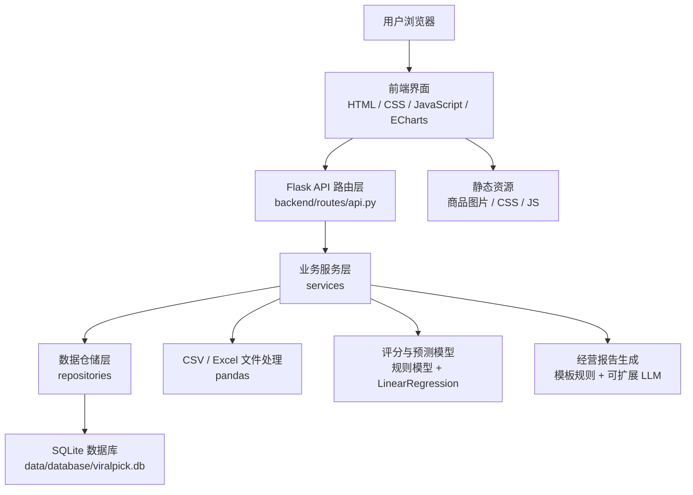
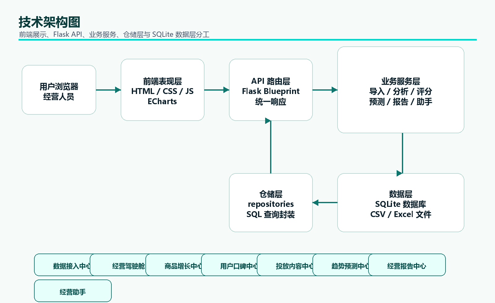
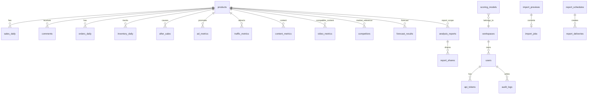
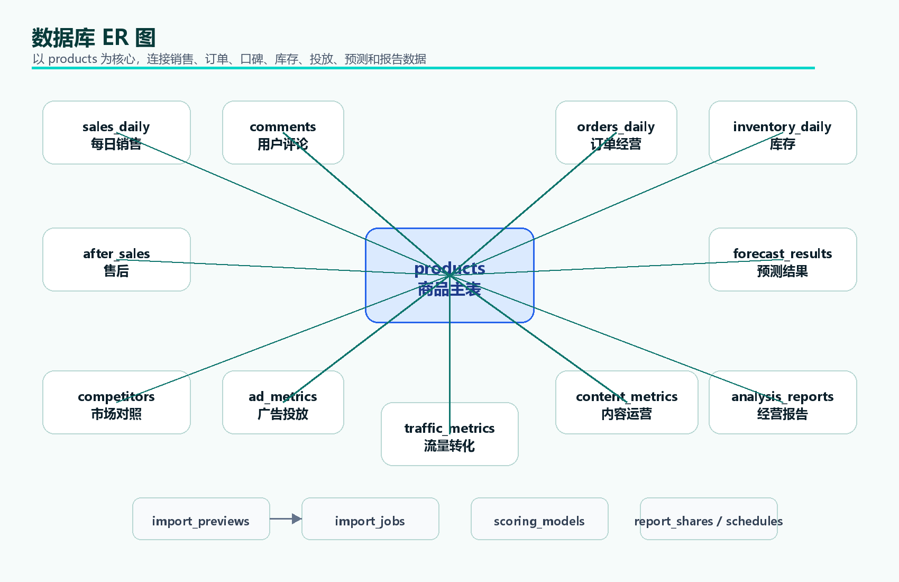
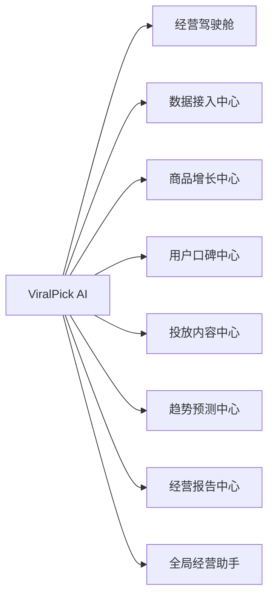
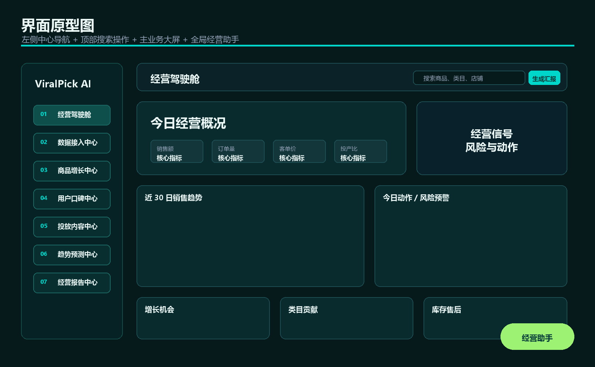
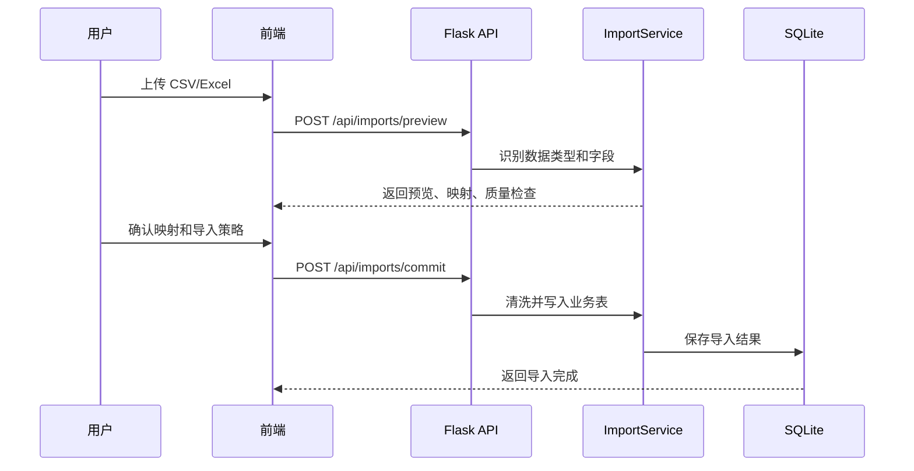
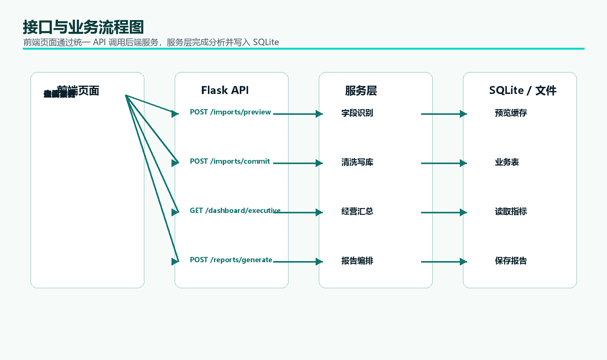
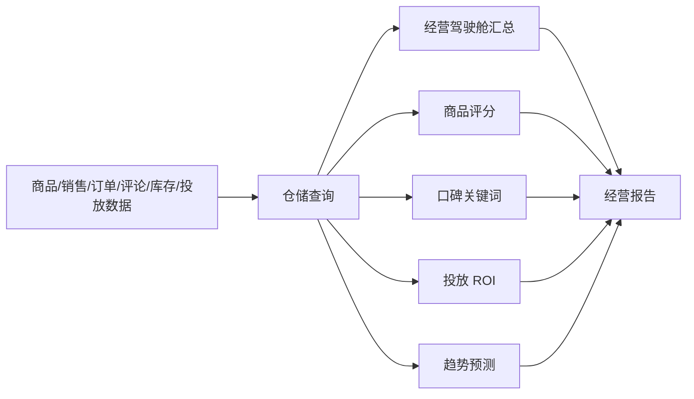
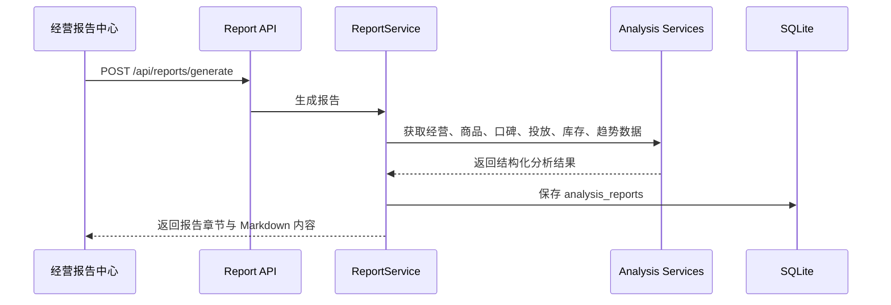

# ViralPick AI 系统设计文档

> 项目定位：基于 Python 的多平台电商智能经营与增长决策平台  
> 技术路线：Flask + SQLite + pandas/numpy + scikit-learn + ECharts + 原生前端  
> 文档范围：数据库设计、ER 图、界面原型、技术架构、模块分层、接口设计  
> 文档版本：V1.0  

---

## 1. 设计目标

系统设计围绕“多平台经营数据接入、经营分析、增长决策、报告输出”形成闭环。当前阶段优先保证项目可运行、可展示、可答辩，同时保留后续扩展真实平台 API、更多模型和更多报告模板的空间。

| 目标 | 设计要求 |
|---|---|
| 可运行 | 本地启动即可进入系统，核心页面不依赖外部平台账号 |
| 可展示 | 前端采用深色数据大屏风格，突出指标、图表、商品图片和动作建议 |
| 可扩展 | 后端按路由、服务、仓储、工具分层，业务模块可独立扩展 |
| 可追溯 | 导入、预测、报告等关键过程有结果表或记录表保存 |
| 可维护 | 数据处理、分析建模、报告生成集中在 Python 后端实现 |

---

## 2. 总体技术架构

系统采用前后端分离但由 Flask 托管静态前端的轻量架构。前端负责页面展示和交互，后端负责数据接入、清洗、分析、预测、报告和助手回答，数据库采用 SQLite 保存结构化经营数据。





### 2.1 架构分层

| 层级 | 目录/文件 | 职责 |
|---|---|---|
| 表现层 | `frontend/index.html`, `frontend/assets` | 页面布局、导航切换、图表渲染、助手入口、文件上传交互 |
| API 层 | `backend/routes/api.py` | 接收 HTTP 请求、参数解析、调用服务、统一响应 |
| 服务层 | `backend/services` | 数据导入、经营看板、商品评分、口碑分析、投放分析、预测、报告、助手 |
| 仓储层 | `backend/repositories` | 封装 SQLite 查询和写入 |
| 数据层 | `data/database/viralpick.db` | 保存商品、销售、评论、库存、售后、投放、报告等数据 |
| 工具层 | `backend/utils`, `scripts` | 响应包装、数据库初始化、迁移、数据准备、测试脚本 |

---

## 3. 功能模块设计

### 3.1 前端业务中心

| 中心 | 页面职责 | 主要数据来源 |
|---|---|---|
| 经营驾驶舱 | 展示销售、订单、投产比、趋势、机会、风险和今日动作 | `dashboard/executive`, `analysis/sales`, `marketing/summary`, `inventory/summary` |
| 数据接入中心 | 上传文件、识别数据类型、字段映射、质量检查、确认导入 | `imports/schema`, `imports/preview`, `imports/commit` |
| 商品增长中心 | 商品货架、商品详情、商品评分、价格带、排行、增长动作 | `products`, `hot-products/scoring`, `analysis/price-bands` |
| 用户口碑中心 | 情绪分布、关键词、差评归因、用户痛点、评论记录 | `comments/sentiment`, `comments/keywords` |
| 投放内容中心 | 广告指标、投放漏斗、内容素材、优化建议 | `marketing/summary` |
| 趋势预测中心 | 历史趋势、未来预测、库存售后、补货和滞销关注 | `forecast/sales`, `inventory/summary` |
| 经营报告中心 | 经营摘要、综合报告、执行安排、报告导出 | `reports/generate`, `reports/<id>`, `reports/<id>/export` |

### 3.2 后端核心服务

| 服务 | 文件 | 核心能力 |
|---|---|---|
| 数据导入服务 | `import_service.py` | 数据类型识别、字段映射、质量检查、导入提交 |
| 经营中心服务 | `business_center_service.py` | 经营驾驶舱、投放内容、库存售后汇总 |
| 商品服务 | `product_service.py` | 商品列表、商品详情、筛选和排序 |
| 销售分析服务 | `sales_analysis_service.py` | 销售概览、类目占比、价格带分析 |
| 商品评分服务 | `hot_score_service.py` | 增长评分、维度分、风险标签、运营建议 |
| 评论分析服务 | `comment_nlp_service.py` | 情绪统计、关键词提取、痛点归因 |
| 趋势预测服务 | `forecast_service.py` | 销量/销售额预测、趋势方向、置信说明 |
| 报告服务 | `report_service.py` | 经营报告生成、结构化章节、Markdown 内容 |
| 助手服务 | `assistant_service.py` | 通用问答、经营问答、页面上下文回答 |

---

## 4. 数据库设计

### 4.1 数据库选型

| 项目 | 说明 |
|---|---|
| 数据库 | SQLite |
| 数据库文件 | `data/database/viralpick.db` |
| 初始化脚本 | `scripts/init_database.py` |
| 迁移脚本 | `scripts/migrate_database.py` |
| 设计原则 | 先保证本地可运行和可展示，后续可迁移至 MySQL |

### 4.2 ER 图





### 4.3 核心业务表结构

#### `products` 商品主表

| 字段 | 类型 | 说明 |
|---|---|---|
| `product_id` | TEXT PK | 商品唯一标识 |
| `stock_code` | TEXT | 商家编码 |
| `product_name` | TEXT | 商品名称 |
| `platform` | TEXT | 平台 |
| `brand` | TEXT | 品牌 |
| `shop_name` | TEXT | 店铺名称 |
| `image_url` | TEXT | 商品图片地址 |
| `selling_points` | TEXT | 商品卖点 |
| `category` | TEXT | 商品类目 |
| `avg_price` | REAL | 平均价格 |
| `total_sales_quantity` | INTEGER | 累计销量 |
| `total_gmv` | REAL | 累计销售额 |
| `rating` | REAL | 商品评分 |
| `positive_rate` | REAL | 好评率 |
| `sales_growth_rate` | REAL | 销量增长率 |
| `gmv_growth_rate` | REAL | 销售额增长率 |
| `hot_potential_score` | REAL | 商品增长评分 |
| `risk_level` | TEXT | 风险等级 |

#### `sales_daily` 每日销售表

| 字段 | 类型 | 说明 |
|---|---|---|
| `id` | INTEGER PK | 自增主键 |
| `date` | TEXT | 日期 |
| `product_id` | TEXT FK | 商品 ID |
| `product_name` | TEXT | 商品名称 |
| `category` | TEXT | 类目 |
| `sales_quantity` | INTEGER | 销量 |
| `gmv` | REAL | 销售额 |
| `order_count` | INTEGER | 订单数 |
| `avg_unit_price` | REAL | 平均件单价 |

#### `comments` 用户评论表

| 字段 | 类型 | 说明 |
|---|---|---|
| `comment_id` | TEXT PK | 评论 ID |
| `product_id` | TEXT FK | 商品 ID |
| `mapped_product_category` | TEXT | 商品类目 |
| `review_text` | TEXT | 评论内容 |
| `sentiment` | TEXT | 情绪文本标签 |
| `sentiment_label` | INTEGER | 情绪数值标签 |
| `rating` | INTEGER | 评分 |
| `category_source` | TEXT | 评论类目来源 |
| `data_source` | TEXT | 数据来源 |

#### `orders_daily` 订单经营表

| 字段 | 类型 | 说明 |
|---|---|---|
| `id` | INTEGER PK | 自增主键 |
| `date` | TEXT | 日期 |
| `platform` | TEXT | 平台 |
| `product_id` | TEXT FK | 商品 ID |
| `product_name` | TEXT | 商品名称 |
| `order_count` | INTEGER | 订单数 |
| `paid_amount` | REAL | 支付金额 |
| `customer_unit_price` | REAL | 客单价 |
| `refund_amount` | REAL | 退款金额 |
| `conversion_rate` | REAL | 转化率 |

#### `inventory_daily` 库存表

| 字段 | 类型 | 说明 |
|---|---|---|
| `id` | INTEGER PK | 自增主键 |
| `date` | TEXT | 日期 |
| `product_id` | TEXT FK | 商品 ID |
| `product_name` | TEXT | 商品名称 |
| `stock_quantity` | INTEGER | 总库存 |
| `available_stock` | INTEGER | 可售库存 |
| `replenishment_threshold` | INTEGER | 补货阈值 |
| `stockout_risk` | TEXT | 缺货风险 |
| `slow_moving_days` | INTEGER | 滞销天数 |

#### `after_sales` 售后表

| 字段 | 类型 | 说明 |
|---|---|---|
| `after_sale_id` | TEXT PK | 售后 ID |
| `date` | TEXT | 日期 |
| `platform` | TEXT | 平台 |
| `product_id` | TEXT FK | 商品 ID |
| `product_name` | TEXT | 商品名称 |
| `refund_amount` | REAL | 退款金额 |
| `refund_count` | INTEGER | 退款笔数 |
| `reason` | TEXT | 售后原因 |
| `status` | TEXT | 处理状态 |

#### `ad_metrics` 广告投放表

| 字段 | 类型 | 说明 |
|---|---|---|
| `id` | INTEGER PK | 自增主键 |
| `date` | TEXT | 日期 |
| `platform` | TEXT | 平台 |
| `campaign_name` | TEXT | 计划名称 |
| `product_id` | TEXT FK | 商品 ID |
| `spend` | REAL | 花费 |
| `impressions` | INTEGER | 曝光 |
| `clicks` | INTEGER | 点击 |
| `conversions` | INTEGER | 转化 |
| `revenue` | REAL | 成交金额 |
| `roi` | REAL | 投产比 |

#### `traffic_metrics` 流量转化表

| 字段 | 类型 | 说明 |
|---|---|---|
| `id` | INTEGER PK | 自增主键 |
| `date` | TEXT | 日期 |
| `platform` | TEXT | 平台 |
| `product_id` | TEXT FK | 商品 ID |
| `visitors` | INTEGER | 访客 |
| `page_views` | INTEGER | 浏览 |
| `cart_adds` | INTEGER | 加购 |
| `favorites` | INTEGER | 收藏 |
| `payment_conversion_rate` | REAL | 支付转化率 |

#### `content_metrics` 内容运营表

| 字段 | 类型 | 说明 |
|---|---|---|
| `id` | INTEGER PK | 自增主键 |
| `date` | TEXT | 日期 |
| `platform` | TEXT | 平台 |
| `content_type` | TEXT | 内容类型 |
| `topic` | TEXT | 内容主题 |
| `product_id` | TEXT FK | 商品 ID |
| `impressions` | INTEGER | 曝光 |
| `interactions` | INTEGER | 互动 |
| `guided_revenue` | REAL | 引导成交 |
| `effect_score` | REAL | 内容效果分 |

#### `competitors` 市场对照表

| 字段 | 类型 | 说明 |
|---|---|---|
| `competitor_id` | TEXT PK | 对照商品 ID |
| `product_id` | TEXT FK | 本品 ID |
| `competitor_name` | TEXT | 对照商品名称 |
| `competitor_platform` | TEXT | 对照平台 |
| `competitor_shop_name` | TEXT | 对照店铺 |
| `competitor_price` | REAL | 对照价格 |
| `competitor_sales_quantity` | INTEGER | 对照销量 |
| `competitor_rating` | REAL | 对照评分 |
| `competitor_positive_rate` | REAL | 对照好评率 |
| `main_selling_point` | TEXT | 主要卖点 |

### 4.4 过程与结果表

| 表名 | 作用 |
|---|---|
| `import_previews` | 保存导入预览、字段映射、预览行、质量检查结果 |
| `import_jobs` | 保存导入执行记录、导入策略、状态、行数和错误信息 |
| `forecast_results` | 保存预测历史序列、预测序列和预测摘要 |
| `analysis_reports` | 保存经营报告 JSON 和报告标题 |
| `scoring_models` | 保存商品评分模型权重和启用状态 |
| `dataset_metadata` | 保存数据集来源、规模和生成时间等元信息 |

### 4.5 兼容与扩展表

| 表名 | 说明 |
|---|---|
| `workspaces`, `users`, `api_tokens` | 历史版本身份与空间表，当前主流程不展示 |
| `audit_logs`, `brand_settings` | 历史版本审计与品牌配置表，保留用于后续扩展 |
| `report_schedules`, `report_deliveries`, `report_shares` | 报告调度、发送和分享扩展能力 |
| `automation_runs` | 自动任务运行记录 |
| `video_metrics` | 内容互动兼容表，前端统一展示为内容运营数据 |

---

## 5. 界面原型设计

### 5.1 信息架构



### 5.2 主界面原型

```text
┌────────────────────────────────────────────────────────────────────────────┐
│ ViralPick AI                           搜索商品/类目/店铺   刷新  生成汇报 │
├───────────────┬────────────────────────────────────────────────────────────┤
│ 01 经营驾驶舱 │  页面标题区：当前中心名称、核心说明、快捷操作             │
│ 02 数据接入   │ ┌──────────────────────┐ ┌──────────────────────────────┐ │
│ 03 商品增长   │ │  核心指标 / 图表      │ │  风险信号 / 今日动作        │ │
│ 04 用户口碑   │ └──────────────────────┘ └──────────────────────────────┘ │
│ 05 投放内容   │ ┌────────────┐ ┌────────────┐ ┌────────────┐              │
│ 06 趋势预测   │ │ 业务模块 A │ │ 业务模块 B │ │ 业务模块 C │              │
│ 07 经营报告   │ └────────────┘ └────────────┘ └────────────┘              │
│ 今日重点       │                                      右下角：经营助手     │
└───────────────┴────────────────────────────────────────────────────────────┘
```



### 5.3 各中心页面原型

| 页面 | 布局原型 |
|---|---|
| 经营驾驶舱 | 顶部核心指标 + 趋势图 + 今日动作 + 增长机会 + 风险预警 + 类目贡献 |
| 数据接入中心 | 上传区 + 数据类型选择 + 字段映射 + 质量检查 + 导入确认 + 预览表格 |
| 商品增长中心 | 商品货架 + 当前商品洞察 + 爆品评分图 + 价格带图 + 商品排行 |
| 用户口碑中心 | 商品切换器 + 情绪图 + 好评关键词 + 差评归因 + 痛点 + 评论记录 |
| 投放内容中心 | 投放指标 + 漏斗图 + 内容素材列表 + 素材排行 + 优化建议 |
| 趋势预测中心 | 商品切换器 + 预测图 + 库存售后信号 + 补货滞销关注 + 预测明细 |
| 经营报告中心 | 经营摘要 + 报告正文 + 汇报摘要 + 执行安排 + 助手面板 |

---

## 6. 接口设计

### 6.1 统一响应格式

成功响应：

```json
{
  "success": true,
  "data": {}
}
```

失败响应：

```json
{
  "success": false,
  "error": "错误信息"
}
```

### 6.2 核心接口分组

| 模块 | 方法 | 接口 | 说明 |
|---|---|---|---|
| 系统状态 | GET | `/api/health` | 健康检查 |
| 系统状态 | GET | `/api/ready` | 数据库与服务就绪检查 |
| 数据接入 | GET | `/api/imports/schema` | 获取支持的数据类型和字段 |
| 数据接入 | POST | `/api/imports/preview` | 上传文件并生成预览 |
| 数据接入 | POST | `/api/imports/commit` | 确认导入预览数据 |
| 经营驾驶舱 | GET | `/api/dashboard/executive` | 获取经营总览 |
| 商品增长 | GET | `/api/products` | 商品列表、筛选和排序 |
| 商品增长 | GET | `/api/products/<product_id>` | 商品详情 |
| 商品增长 | GET | `/api/hot-products/scoring` | 商品增长评分 |
| 商品增长 | GET | `/api/analysis/sales` | 销售分析 |
| 商品增长 | GET | `/api/analysis/price-bands` | 价格带分析 |
| 用户口碑 | GET | `/api/comments/sentiment` | 评论情绪分布 |
| 用户口碑 | GET | `/api/comments/keywords` | 评论关键词和痛点 |
| 投放内容 | GET | `/api/marketing/summary` | 投放和内容表现 |
| 趋势预测 | GET | `/api/inventory/summary` | 库存售后摘要 |
| 趋势预测 | GET | `/api/forecast/sales` | 销量和销售额预测 |
| 经营报告 | POST | `/api/reports/generate` | 生成综合经营报告 |
| 经营报告 | GET | `/api/reports/<report_id>` | 查询报告详情 |
| 经营报告 | GET | `/api/reports/<report_id>/export` | 导出报告 |
| 经营助手 | POST | `/api/assistant/chat` | 智能经营问答 |

### 6.3 关键接口结构

#### 数据导入预览

`POST /api/imports/preview`

| 参数 | 类型 | 必填 | 说明 |
|---|---|---|---|
| `file` | file | 是 | CSV 或 Excel 文件 |
| `dataset_type` | string | 否 | 指定数据类型；为空时自动识别 |

返回核心字段：

| 字段 | 说明 |
|---|---|
| `preview_id` | 导入预览 ID |
| `dataset_type` | 识别出的数据类型 |
| `source_columns` | 源文件字段 |
| `field_mapping` | 推荐字段映射 |
| `preview_rows` | 预览行 |
| `quality` | 质量检查结果 |

#### 商品列表

`GET /api/products`

| 参数 | 说明 |
|---|---|
| `keyword` | 商品、品牌、店铺关键词 |
| `category` | 类目筛选 |
| `risk_level` | 风险等级 |
| `sort` | 排序字段 |
| `order` | 升序或降序 |
| `page`, `page_size` | 分页 |

#### 趋势预测

`GET /api/forecast/sales`

| 参数 | 说明 |
|---|---|
| `product_id` | 商品 ID，可选 |
| `category` | 类目，可选 |
| `days` | 预测天数：7、14、30 |

#### 经营助手

`POST /api/assistant/chat`

```json
{
  "message": "今天应该优先处理什么？",
  "product_id": "P0001",
  "page": "dashboard",
  "use_llm": true
}
```

---

## 7. 关键业务流程

### 7.1 数据导入流程





### 7.2 经营分析流程



### 7.3 报告生成流程



---

## 8. 模块依赖关系

| 上层模块 | 依赖模块 | 说明 |
|---|---|---|
| 前端页面 | `api.js`, `app.js`, `ECharts` | 统一调用 API 并渲染图表 |
| API 路由 | 服务层 | 只处理请求参数和响应格式 |
| 服务层 | 仓储层、pandas、模型工具 | 处理业务规则、分析计算和报告生成 |
| 仓储层 | `db.py` | 执行 SQLite 查询 |
| 数据导入 | pandas、导入 schema、业务表 | 负责文件识别、清洗、映射和写库 |
| 经营助手 | 本地经营上下文、可扩展 LLM | 优先基于系统数据回答，再进行增强 |

---

## 9. 部署与运行设计

| 项目 | 设计 |
|---|---|
| 运行方式 | 本地 Flask 服务托管 API 与前端静态文件 |
| 默认地址 | `http://127.0.0.1:5000` |
| 初始化 | `python scripts/init_database.py --force` |
| 启动 | `python backend/app.py` |
| 迁移 | `python scripts/migrate_database.py` |
| 测试 | `pytest`, `python scripts/smoke_test.py --check-frontend` |

---

## 10. 可扩展设计

| 扩展方向 | 当前预留 |
|---|---|
| 数据库扩展 | SQLite 表结构清晰，后续可迁移 MySQL |
| 平台接口接入 | 当前先支持文件导入，后续可增加平台授权 API |
| 分析模型扩展 | 当前使用规则评分和轻量预测，后续可替换更复杂模型 |
| 报告能力扩展 | 当前规则模板生成，可扩展更多模板和大模型增强 |
| 权限与协作 | 历史表结构保留，但当前正式前端不展示 |

---

## 11. 设计总结

ViralPick AI 的系统设计采用轻量但完整的业务闭环：前端负责经营大屏和交互，Flask 后端负责业务分析，SQLite 负责数据持久化，Python 服务层负责导入清洗、商品评分、口碑分析、投放分析、趋势预测和报告生成。

系统的核心设计价值在于：把分散的多平台经营数据转化为统一的经营指标、风险信号和行动建议，使网店经营者能够更快完成经营复盘和增长决策。
